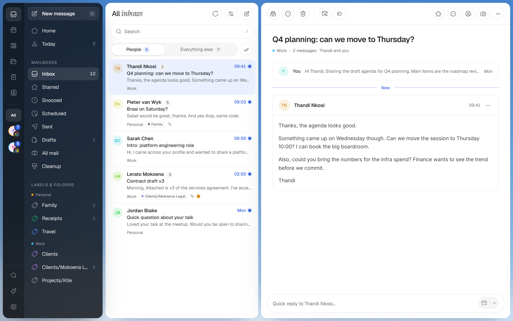
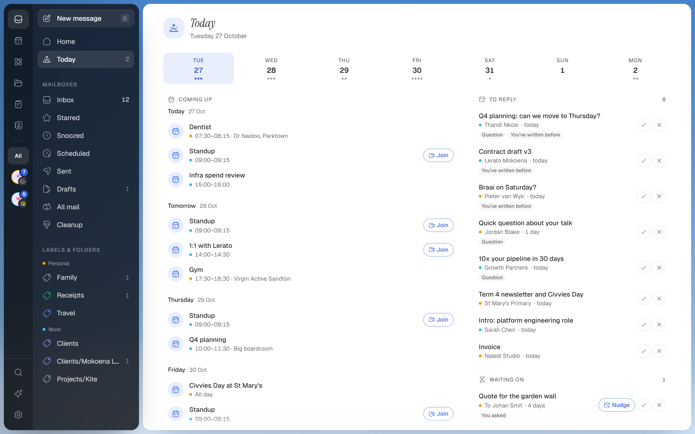
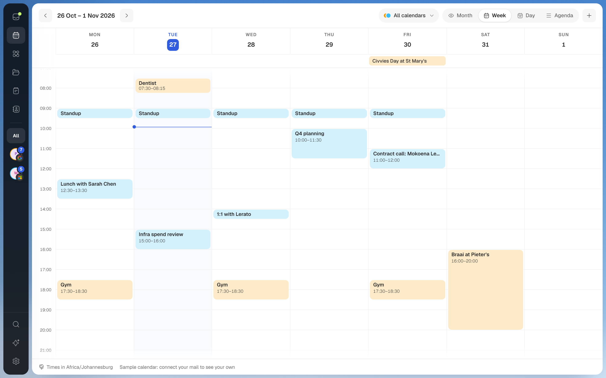
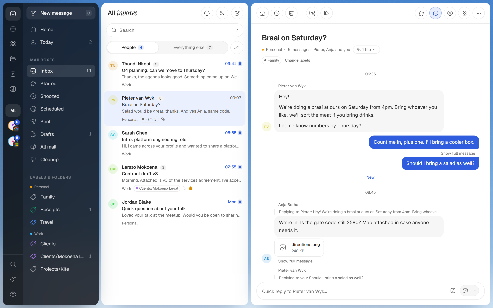
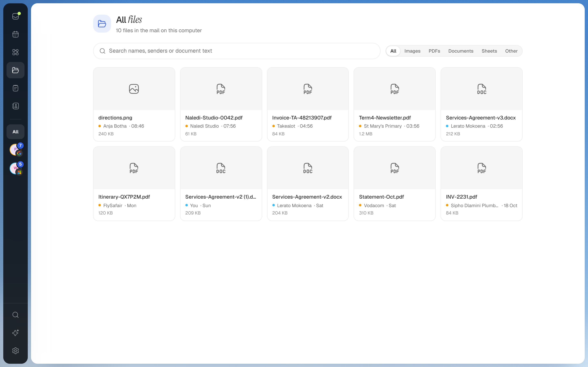

<p align="center">
  
</p>

<h1 align="center">Kite</h1>

<p align="center"><b>Email that <i>flies.</i></b></p>

<p align="center">
  A fast, keyboard-first email client. Your mail lives on your computer,<br>
  so lists and search never wait on the network.
</p>

<p align="center">
  <a href="https://kite-jet-five.vercel.app">Website</a> ·
  Windows app coming soon ·
  <a href="docs/bar.md">The Kite bar API</a>
</p>

<br>

<picture>
  <source media="(prefers-color-scheme: dark)" srcset="docs/screenshots/inbox-dark.png">
  
</picture>

<br>

## Your whole day, *one key away*

Every view has its own shortcut, and every shortcut is yours to change.

| | | |
|---|---|---|
| **Every inbox, one list** | <kbd>J</kbd> <kbd>K</kbd> | Mail from every account, straight from your disk. <kbd>E</kbd> archives, <kbd>Z</kbd> undoes. |
| **Today** | <kbd>T</kbd> | Who's waiting on your reply, who you're waiting on, what's coming up. Nudge in one tap. |
| **Calendar** | <kbd>W</kbd> | Your week beside your mail. Answer an invite from the email. |
| **Chat view** | | Any conversation as bubbles, quotes and signatures folded away. |
| **All files** | | Every attachment from every account, previewed in place. Fill and sign PDFs too. |
| **Command palette** | <kbd>Ctrl</kbd> <kbd>K</kbd> | Every action, label, person and setting a few letters away. |

<table>
  <tr>
    <td></td>
    <td></td>
  </tr>
  <tr>
    <td></td>
    <td></td>
  </tr>
</table>

## Ask like Gmail. *Answer from disk.*

The same search words in every account, Outlook and IMAP too. A capital `OR` joins two terms, a `-` leaves one out.

```text
from:thandi is:unread                          unread from one person
invoice OR receipt has:attachment filename:pdf invoices with a PDF
"verification code" newer_than:1d              sign-in codes today
has:attachment older_than:1y -is:starred       old files to clear out
```

## It does the chores. *You decide.*

Automations are built by example: pick whose emails, click what to read in a real one (an amount, a due date, a tracking link), then switch on what happens. No AI, no rules language, a 30-day preview, and Undo for every run.

| What Kite does for you | What waits for your click |
|---|---|
| Strips tracking pixels and cleans tracking from links | Summarise, Draft, Rewrite: your own AI key, only the emails you picked |
| Finds sign-in codes as they arrive, one click to copy | Every send, with Undo: send later, send separately, follow up |
| Files invoices into a collection, totalled by month | Unsubscribe and block, one sender or a hundred, from Cleanup |
| Remembers who owes you a reply, the nudge ready | Images from strangers, held so nobody sees you opened it |

## Codes, meetings, mail. *Up top.*

In the desktop app, a strip of Kite's sky floats at the top of your screen. A sign-in code drops in ready to copy, a meeting counts down with Join, and the mail you said matters comes with a quick reply.

Any script on your PC can use it too: send JSON, get a bar.

```bash
curl -X POST http://127.0.0.1:3100/api/bar/activities \
  -H "Authorization: Bearer $KITE_BAR_TOKEN" -H "content-type: application/json" \
  -d '{"title":"Deploying kite-web","icon":"deploy","value":{"type":"progress","progress":0.6}}'
```

Progress, codes, countdowns and buttons, updated in place by key. The whole API: [docs/bar.md](docs/bar.md).

## Private *by default*

- Your mail is a local copy in one SQLite file. Disconnect removes everything tied to that account.
- Remote images wait for you; a shield on each message shows what was removed and whether the sender is verified.
- AI runs only when you click a named action, inside the daily and monthly limits you set. Settings → Privacy lists everything that ever left your computer.
- Secrets are sealed on disk. <kbd>Shift</kbd> <kbd>P</kbd> blurs names and bodies; a PIN locks the app.

## Works with

Gmail · Google Workspace · Outlook · Microsoft 365 · iCloud · Yahoo · Fastmail · Zoho · GMX · AOL · any IMAP server. Type your address and Kite finds the rest.

## Run it

Needs Node 25 and pnpm 11.

Desktop release and signed in-app update instructions: [docs/updates.md](docs/updates.md).

```bash
pnpm install
cp .env.example .env.local   # your Google and Microsoft OAuth clients
pnpm dev                     # http://localhost:3100, demo data until you connect an account
pnpm desktop                 # the Windows app (Tauri, needs Rust)
```

Screenshots come from the demo data (`kite-demo` server, then `node scripts/readme-shots.mjs`). The website is static in [docs/](docs/). How the code fits together: [CLAUDE.md](CLAUDE.md). What's next: [ROADMAP.md](ROADMAP.md).

<br>

<p align="center"><sub>Built by Mark Steyn</sub></p>
